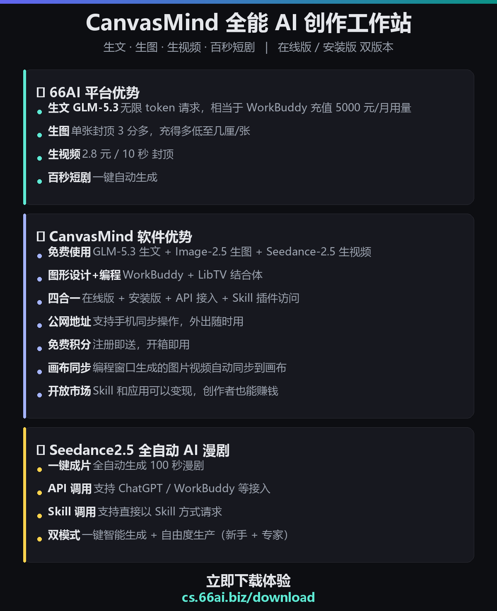

# CanvasMind · 无限画布 AI 创作工作站

> 一站式 AI 创作软件 · Windows 客户端 · 开箱即用
> 无限画布 × AI 对话 × AI 生图 × AI 视频 × 百秒短剧

## 🆓 三大免费主打

| 免费能力 | 说明 |
|----------|------|
| 🆓 **免费 GLM-5.3 生文** | 顶级大模型，写作 / 问答 / 代码全能，注册即用 |
| 🆓 **免费 GPT-Image-2 生图** | **2K 超高清品质**，8 种比例（16:9 / 9:16 / 1:1 / 3:4 / 4:3 / 3:2 / 2:3 / 21:9），PNG / JPG 自选 |
| 🆓 **免费 Seedance 2.0 视频** | **10 秒高清短视频**一键生成，支持 4K，画幅自由选 |

## 🏆 66AI 平台优势

- 💬 **生文 GLM-5.3**：无限 token 请求，相当于 WorkBuddy 充值 5000 元/月的用量
- 🖼 **生图**：单张封顶 3 分钱，充得越多低至几厘，2K 品质不加价
- 🎬 **生视频**：2.8 元 / 10 秒封顶，支持 4K 高清
- 📺 **百秒短剧**：一键自动生成完整成片

## 🚀 CanvasMind 软件优势

- 🎁 **免费使用**：GLM-5.3 生文 + GPT-Image-2 生图 + Seedance 2.0 生视频，注册即送体验积分
- 🧠 **双引擎结合体**：WorkBuddy + LibTV 合体（图形设计 + 编程）
- 🔌 **四合一接入**：在线版 + 安装版 + API 接口 + Skill 插件，一套能力四处用
- 📡 **公网远程**：自动生成公网地址，手机随时随地打开自己的画布
- ♾️ **无限画布**：节点式编排，文本 / 图片 / 视频 / 音频自由组合
- 💬 **多画布独立对话**：每块画布独立 AI 会话，互不干扰，运行状态实时监控
- 🖼 **画布同步**：编程窗口生成的图片 / 视频自动上画布
- 🛒 **开放市场**：Skill 和应用可以上架变现，创作者也能赚钱
- 🔒 **本地数据**：画布与素材保存在本机，随时备份

## 🎞 Seedance 全自动 AI 漫剧优势

- ⚡ **全自动**：一键生成 100 秒成片（分镜剧本 → 画面 → 合成）
- 🔗 **API 调用**：支持 ChatGPT、WorkBuddy 等第三方 API 调用
- 🧩 **Skill 调用**：支持以 Skill 方式直接请求生成
- 🎚 **双模式**：一键智能生成 + 自由度生产（新手 + 专家模式）

## 📥 下载安装（3 步开画）

1. 到 **[Releases 下载安装包](https://github.com/66ai-biz/CanvasMind/releases/latest)** （`CanvasMind-setup-v2.7.7.exe`，约 120 MB）
2. 双击安装 —— **无需管理员权限**，装完自动启动
3. 浏览器自动打开工作台，**注册即送体验积分，马上免费体验上面全部 AI 能力**

> 备用下载：http://cm.66ai.biz/download
>
> 安装提示：如遇 Windows SmartScreen 蓝色提示，点「更多信息」→「仍要运行」；杀毒软件拦截请添加信任。

## ⚙️ 系统要求

- Windows 10 / 11 · 64 位
- 无需额外配置 Python / Node 环境（安装包内置）

## 📦 版本

| 版本 | 说明 |
|------|------|
| v2.7.7 | 图片 8 比例 × 1K/2K × PNG/JPG 全参数化；4K 视频档；成片自动去水印；支持在线升级 |

详细安装与常见问题见 [安装说明.txt](安装说明.txt)。

---

*CanvasMind · 本仓库由官方提供，安装即代表同意软件使用协议。*
